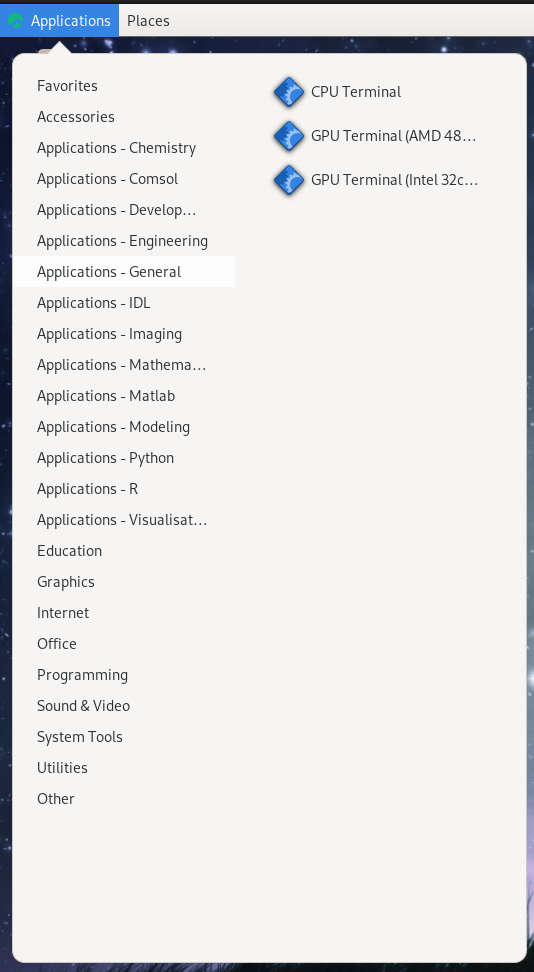
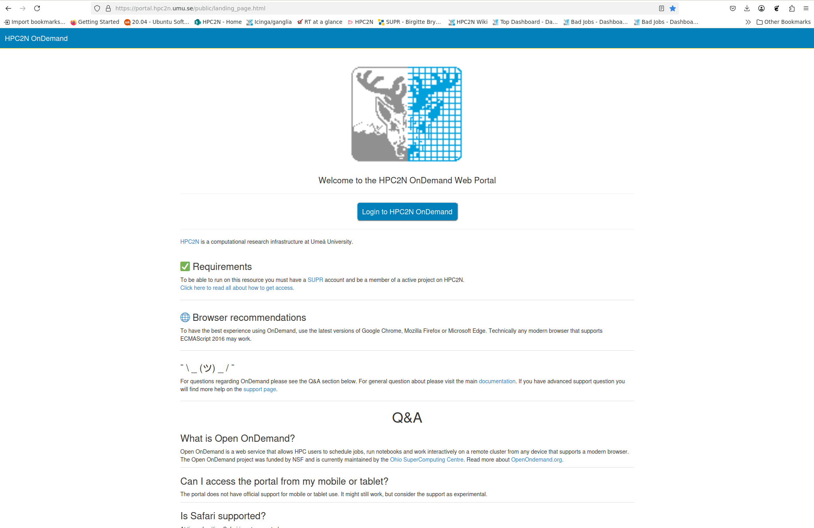
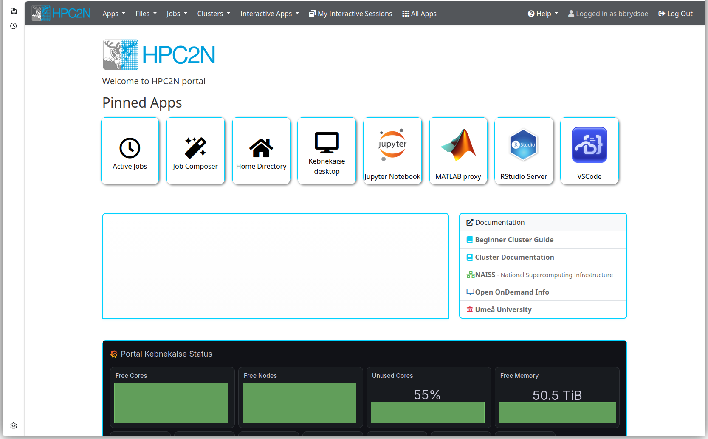
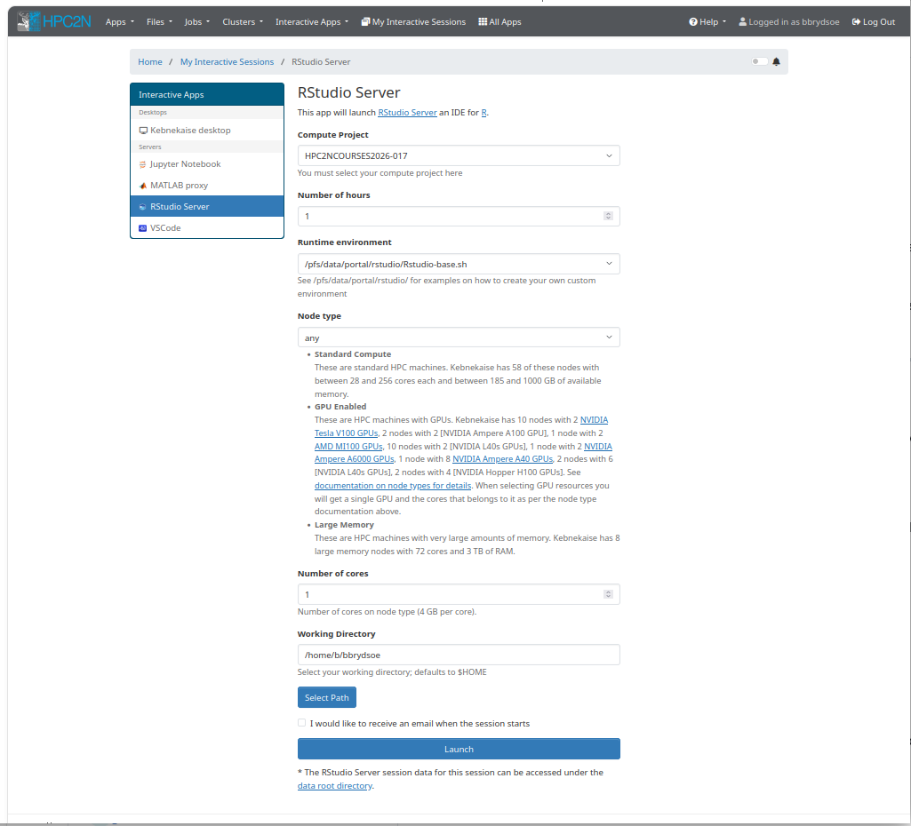

# Using RStudio through OpenOnDemand

!!! note "Learning outcomes" 

    - Learn about OpenOnDemand
    - See how Rstudio can be started through it 

## OpenOnDemand

Some of the centres have a different, graphical way of starting interactive jobs. 

This is not currently the case for NAISS Arrhenius, but the plan is to have it in the future. It will likely either be like on Pelle and Dardel, or like on Kebnekaise (and Alvis). Thus we will cover both options. 

!!! note "Desktop OnDemand"

    Desktop On-Demand is most appropriate for *interactive* work requiring small-to-medium amounts of computing resources. Non-interactive jobs and jobs that take more than a day or so should generally be submitted as batch jobs. If you have a longer job that requires an interactive interface to submit, make sure you keep track of the wall time limits for your facility. Some of the Desktop On Demand's only allow at most 12 hours of allocation at a time.

    On-Demand applications are *not* accessible via SSH; you must use either Thinlinc (Cosmos and Dardel) or the dedicated web portal (Kebnekaise and Alvis).

### Gfx launcher 

- **Cosmos** and **Dardel** use the On-Demand Desktop developed at LUNARC, which is accessible via Thinlinc.

For most programs, the start-up process is roughly the same:

1. Log into the system via your usual Thinlinc client or browser interface to start an HPC Desktop session.
2. Click ``Applications`` in the top left corner, hover over the items prefixed with ``Applications -`` until you find your desired application (on Dardel, On-Demand applications are prefixed with ``PDC-``), and click it. The top-level Applications menu on Cosmos looks like this:

!!! warning

    If you start a terminal session or another application from ``Favorites``, ``System Tools``, or other menu headings not prefixed with ``Applications -`` or ``PDC-``, and launch an interactive program from that, it will run on a login node. Do not run intensive programs this way!

### OpenOnDemand portal 

- **Kebnekaise** and **Alvis** uses Open OnDemand via a [dedicated web portal](https://portal.hpc2n.umu.se). 

To start an Open OnDemand session on Kebnekaise,

1. Open [https://portal.hpc2n.umu.se](https://portal.hpc2n.umu.se) in your browser. The page looks like this:

2. Click the blue button labeled "Login to HPC2N OnDemand".
3. A login window should open with boxes for your login credentials. Enter your HPC2N username and password, then click "Sign In".
4. You will now be on the HPC2N Open OnDemand dashboard. The top of it looks like this:

5. Find the ``Interactive Apps`` tab in the menu bar along the top and click it to open a drop-down menu of available apps or pick one of the "buttons" on the dashboard showing the available apps. 

!!! warning 

    Unlike on Cosmos and Dardel, On-Demand applications on Kebnekaise are **not** reachable through Thinlinc, regardless of whether you use the desktop client or a browser! If you find similar-looking applications in the Thinlinc interface, be aware that they all run on login nodes!

## RStudio through OpenOnDemand 

How to open RStudio through OpenOnDemand depends on whether it is through ThinLinc+Gfx launcher or through the OpenOnDemand portal. 

### ThinLinc + Gfx launcher 

- Login using ThinLinc
- Find the Gfx launcheable items through the "Applications" in the menu. Click "Applications - R". You can then pick which version of Rstudio you want. It looks like this on Cosmos: 
[Applications of Cosmos](../img/Cosmos-AppMenu-RStudio.png)
- When you click the RStudio, you will get a Gfx launcher window where you can set things like walltime, resources, project, etc. 
- Then click "Start", Rstudio will open. 

!!! warning 

    1. **Wall time** - how long your interactive session will remain open. *When it ends, the whole window closes immediately and any unsaved work is lost.* You can select the time from a drop-down menu, or type in the time manually. On Cosmos, CPU-only applications (indicated with "(CPU)" in the name) can run for up to 168 hours (7 days), but the rest are limited to 48 hours. Default is 30 minutes.
    2. **Requirements** - how many tasks per node you need. The default is usually 1 or 4 tasks per node. There is also a **gear icon** to the right of this box that can pull up a second menu (see figure below) where you can set
        - the name of your job,
        - the number of tasks per node,
        - the amount of memory per CPU core, and/or
        - whether or not to use a full node.
    3. **Resource** - which kind of node you want in terms of the architecture (AMD or Intel) and number of cores in the CPU (or GPU). Options and defaults vary by program, and the option to change this is not always available.
    4. **Project** - choose from a drop-down menu the project with which your work is associated. This is mainly to keep your usage in line with your allocations and permissions, and to send any applicable invoices to the correct PI.
    5. When you're happy with your settings, click "Start". The GfxLauncher menu will stay open in the background so that you can monitor your wall time usage with the `Usage` bar. Leave this window open---your application depends on it!

### Portal OpenOnDemand 

- Go to [the HPC2N portal](https://portal.hpc2n.umu.se/). Login with your HPC2N login and password. 
- Click on RStudio server on

- You will get a launcher page like this: 

!!! note 

    Let us look at the options for launching this, one by one:

    - Compute Project: Dropdown menu where you can choose (one of) your compute projects to launch with.
    - Number of hours: How long you want the job available for. Here you can choose 1-12 hours, but beware that it is a bad idea to pick longer than you need. Not only will it take longer to start, but it will also use up your allocation even if you are not actively doing anything in RStudio. Pick as long as you need to do your job.
    - Runtime environment: Here you can pick “System provided”, “Project provided”, or “User provided”. If you or your project do not have a custom RStudio environment (for instance with specific packages/libraries or such), then just go with the “System provided”. See examples in the directory at the path /pfs/data/portal/rstudio/ for how to create your own.
    - Node type: “any”, “any GPU”, or “Large memory”. If you pick “any GPU” you cannot also chose “Number of cores”. The other options (for any CPU or for large memory nodes) means you also pick number of cores.
    - Number of cores: This is only shown if you pick “any” or “Large memory” for “Node type”. You can pick 1-28 cores.
    - Working Directory: Pick the working directory to start in. This will be $HOME unless you pick something else (for instance, maybe you prefer to start in your project storage directory). You can either type in the path or you can click the button “Select Path” and choose from the directory tree.

    You can tick the box “I would like to receive an email when the session starts” if you want that. Depending on your choices (mainly number of hours and number of cores), it can take longer or shorter to launch your job. 

This is used to start RStudio server on one (or more) of the compute nodes after you have allocated resources.

This means you will be able to work as if on those resources. That means that anything you run from inside this RStudio immediately runs on the allocated resources, without you having to start (another) job.

Very useful if you want to work interactively. 

You can find a [simple example](https://docs.hpc2n.umu.se/tutorials/connections/#simple__example_2) here. 

