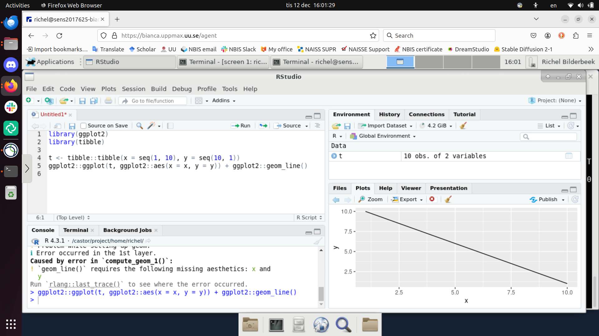

# Using RStudio

!!! info "Learning outcomes"

    - Practice using the documentation of your HPC cluster
    - Start RStudio

???- note "For teachers"

    Teaching goals are:

    - Learners have practiced using the documentation of their HPC clusters
    - Learners have started RStudio

    Prior:

    - What is RStudio?
    - Why is RStudio useful?

## What is RStudio

RStudio is a program that helps you write R code.
A program that helps you write code
is called an IDE (`aj-dee-ee`),
short for 'Integrated Development Environment'.
RStudio has many features you expect from an IDE, 
such as code completion and a debugger.

## Why use RStudio?

- RStudio is a visual and more familiar environment to work in
- RStudio is one of the most popular R IDEs
- RStudio is free and open source
- RStudio works on all major operating system
- RStudio is helpful in many ways, such as code completion,
  showing variables, showing plots, etc

## Exercises

???- hint "Need a video?"

    Here are videos that do this exercises for the different HPC clusters:

    HPC Cluster|YouTube video
    -----------|---------------------------------------------
    Arrhenius  |Not yet possible, hence no video
    Bianca     |[YouTube video](https://youtu.be/rRUb4pqaVak)
    COSMOS     |[YouTube video](https://youtu.be/eT4D_K5JODA)
    Dardel     |[YouTube video](https://youtu.be/IEd5G1bkT4c)
    Kebnekaise |[YouTube video](https://youtu.be/Hy37qVd_Q20)
    Pelle      |[YouTube video](https://youtu.be/90sfHzE_k1k)
    Tetralith  |[YouTube video](https://youtu.be/wfsh6-qk4uM)

???- hint "How difficult will this be?"

    This depends mostly on your HPC cluster:

    <!-- markdownlint-disable MD013 --><!-- Tables cannot be split up over lines, hence will break 80 characters per line -->

    HPC Cluster|Difficulty|Reason
    -----------|----------|-------------------------------------------
    Arrhenius  |Impossible|Not possible yet
    Bianca     |Easy      |Step-by-step documentation
    COSMOS     |Trivial   |Step-by-step documentation, trivial procedure
    Dardel     |Trivial   |Step-by-step documentation, trivial procedure
    Kebnekaise |Trivial   |Step-by-step documentation, trivial procedure
    Pelle      |Easy      |Step-by-step documentation
    Tetralith  |Easy      |Step-by-step documentation

    <!-- markdownlint-enable MD013 -->

## Exercise 1: start RStudio

Use the documentation of your HPC cluster for help.

- Find the user documentation of your HPC cluster

??? hint "Answer"

    <!-- markdownlint-disable MD013 --><!-- Tables cannot be split up over lines, hence will break 80 characters per line -->

    HPC cluster| User documentation for that HPC cluster
    -----------|-----------------------------------------------------------------------------------
    Arrhenius  | [Arrhenius HPC documentation](https://hpc.pages.naiss.se/user-documentation/support-docs/)
    Bianca     | [Bianca user documentation](http://docs.uppmax.uu.se/)
    COSMOS     | [COSMOS user documentation](https://lunarc-documentation.readthedocs.io/en/latest)
    Dardel     | [Dardel user documentation](https://support.pdc.kth.se/doc/contact/contact_support/)
    Kebnekaise | [Kebnekaise user documentation](https://docs.hpc2n.umu.se/)
    LUMI       | [LUMI user documentation](https://docs.lumi-supercomputer.eu/)
    Pelle      | [Pelle user documentation](http://docs.uppmax.uu.se/)
    Tetralith  | [Tetralith user documentation](https://www.nsc.liu.se/support/systems/tetralith-getting-started/)

    <!-- markdownlint-enable MD013 -->

- **For maximally 5 minutes**, search for the procedure on how to start
  RStudio on your HPC cluster. Take a look at the answer if you
  cannot find it: sometimes there *is* no documentation

???- hint "Where is that documentation?"

    <!-- markdownlint-disable MD013 --><!-- Tables cannot be split up over lines, hence will break 80 characters per line -->

    HPC Cluster|Documentation
    -----------|------------
    Arrhenius  |[Arrhenius documentation](https://richel.bilderbeek.pages.naiss.se/support-docs/arrhenius_hpc/software_development/rstudio/)
    Bianca     |[UPPMAX documentation](https://docs.uppmax.uu.se/software/rstudio_on_bianca/)
    COSMOS     |[UPPMAX documentation](https://docs.uppmax.uu.se/naiss/rstudio_on_cosmos/)
    Dardel     |[UPPMAX documentation](https://docs.uppmax.uu.se/naiss/rstudio_on_dardel/)
    Kebnekaise |[UPPMAX documentation](https://docs.uppmax.uu.se/naiss/rstudio_on_kebnekaise/)
    LUMI       |[UPPMAX documentation](https://docs.uppmax.uu.se/naiss/rstudio_on_lumi/)
    Pelle      |[UPPMAX documentation](https://docs.uppmax.uu.se/software/rstudio_on_pelle/)
    Tetralith  |[UPPMAX documentation](https://docs.uppmax.uu.se/naiss/rstudio_on_tetralith/)
    Vera       |[UPPMAX documentation](https://docs.uppmax.uu.se/naiss/rstudio_on_vera/)

    <!-- markdownlint-enable MD013 -->

- Follow that procedure to start RStudio
