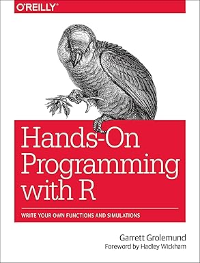
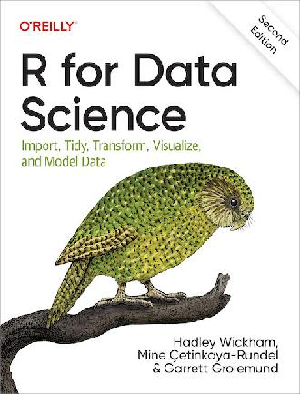
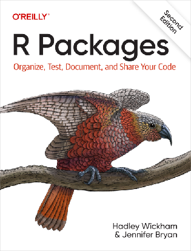
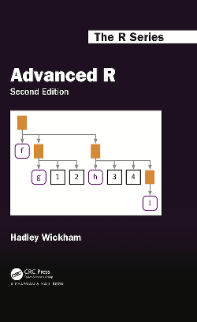

# Summary

You can find the module to be able to run R:

```bash
module spider R
```

You can load the module to be able to run R:

```bash
module load buildtool-easybuild/5.2.1-hpca3ef7d197 GCC/14.3.0 R/4.5.2
```

You can run the R interpreter

```bash
R
```

You can run the R command to get the list of installed R packages

```r
installed.packages()
```

You can run an R script from the command-line

```bash
Rscript my_script.R
```

You can find out if an R package is already installed

```r
installed.packages()
library(my_package)
```

You can load the pre-installed R packages

```bash
module load buildtool-easybuild/5.2.1-hpca3ef7d197 GCC/14.3.0 R/4.5.2 MPICH/4.3.2 R-bundle-CRAN/2025.11
```

You can install an R package from a CRAN mirror:

```r
install.packages("my_package", repos = "http://ftp.acc.umu.se/mirror/CRAN/")
```

You can change the folder where R installs its packages:

```r
echo R_LIBS_USER="$HOME/R-packages-%V" > ~/.Renviron
```

You can submit a job to the scheduler to run an R script with regular code

```bash
sbatch my_batch_script.sh
```

```bash
#!/bin/bash
#SBATCH -A my_account
#SBATCH -t 00:10:00
module load R
Rscript my_script.R
```

You can submit a job to the scheduler to run an R script that uses parallel code

```bash
#!/bin/bash
#SBATCH -A my_account
#SBATCH -t 00:10:00
#SBATCH -N 1
#SBATCH -c 4
R -q --slave -f my_parallel_script.R
```

You can submit a job to the scheduler to run an R script that uses a GPU

```bash
#SBATCH -n 8
#SBATCH -c 72
#SBATCH --gpus 8
#SBATCH -A naiss<project_number>-gpu
#SBATCH -p gpu
```

You can start an interactive session


```bash
interactive -A my_project_code
salloc -A my_project_code
```

You can verify I am on the login node yes/no

```bash
srun hostname
```

You can start an interactive session with multiple cores

```bash
interactive -n 4 -A my_project_code
salloc -n 4 -A my_project_code
```

You can verify my interactive session uses multiple cores

```bash
srun hostname
```

You can start RStudio

```bash
module load R/4.1.1 RStudio/2023.12.1-402
rstudio
```

## Where to go next?

- For other courses: see
  [the SCoRe overview of courses](https://nbisweden.github.io/SCoRe_user_doc/courses/),
  which collects all courses from NAISS, SciLifeLab and many more providers
- For self study: below are free and excellent books

<!-- markdownlint-disable MD013 --><!-- Tables cannot be split up over lines, hence will break 80 characters per line -->

Cover                                            |Book                                                             |Audience
-------------------------------------------------|-----------------------------------------------------------------|--------------------------------
|[Hands-on programming](https://rstudio-education.github.io/hopr/)|Those that have never programmed
 |[R for data science](https://r4ds.hadley.nz/)                    |Beginners
                 |[R packages](https://r-pkgs.org/)                                |Intermediate
                 |[Advanced R](https://adv-r.hadley.nz/)                           |Advanced

<!-- markdownlint-enable MD013 -->
